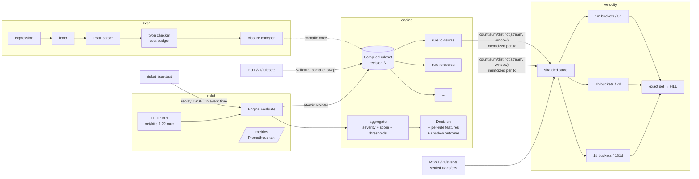

# fraud-rules-go

[](https://github.com/victorcondackdev/fraud-rules-go/actions/workflows/ci.yml)
[](https://pkg.go.dev/github.com/victorcondackdev/fraud-rules-go)

A real-time risk rules engine for instant payments, built around Pix: the
kind of check a PSP runs in the few milliseconds between "customer pressed
send" and "funds leave the account". Rules are written in a small typed
expression language, read sliding-window velocity features, and return an
**explained** decision — every matched rule reports the exact feature values
it saw.

```
isNight(tx.time) && !payer.device.trusted && age(payer.device.first_seen) < 2h
    && count(payer.transfers, 30m) >= 1
```

Standard library only. Go 1.22+.

- **`expr`** — a rule DSL with a hand-written lexer, Pratt parser, type
  checker and closure compiler. Positional errors with carets, a static cost
  budget, no loops, no panics (fuzzed), deterministic. ~35 ns per rule.
- **`velocity`** — a sharded, memory-bounded feature store of sliding-window
  count / sum / distinct per payer, payer→beneficiary pair, device, IP and
  beneficiary, with an HLL++-style sketch for high-cardinality distincts.
- **`engine`** — rulesets with ALLOW / REVIEW / STEP_UP / HOLD / BLOCK,
  additive scores, shadow mode, per-action fail-open/fail-closed, latency
  budget, atomic hot reload and rollback.
- **`backtest`** — replay labeled history and get precision, recall, value
  recall and unique catches per rule, per fraud pattern and overall.
- **`riskd`** (HTTP + Prometheus metrics), **`riskctl`** (validate / eval /
  explain / backtest), **`gen-history`** (synthetic labeled data).

## Why

Pix settles in seconds and is irrevocable from the payer's side; the
dispute mechanism (MED) recovers money only if it is still in the receiving
account. Fraud prevention therefore has to happen *before* the transfer is
released, inside a tight latency budget, and it has to be changed by risk
analysts faster than a deploy cycle.

Most of that logic is not machine learning. It is limits and patterns that
change weekly: lower limits at night, extra care on a device seen for ten
minutes, a first transfer to a key registered yesterday, six beneficiaries
in an hour, transfers sitting just below a limit. This project treats those
rules as data — versioned, validated, backtested, shadowed, hot-swapped —
while keeping evaluation as fast and predictable as compiled code.

The part that is usually missing is **explainability**. A decision that says
`BLOCK` is not enough for the analyst queue, for the customer who calls the
bank, or for a regulator. Here every hit carries the values of every feature
its expression read: the local hour, the device age, the 6-hour outflow, the
count of transfers to this beneficiary in 90 days.

## Architecture



The engine never calls the wall clock to compute features: "now" is the
transaction time and the velocity store buckets by event time. A backtest
therefore sees exactly the features production would have seen.

## Quick start

```sh
go run ./cmd/riskctl validate rulesets/pix-default.json
go run ./cmd/riskctl eval -history testdata/history-sample.jsonl rulesets/pix-default.json testdata/tx-ato-night.json
go run ./cmd/riskctl backtest rulesets/pix-default.json testdata/history-sample.jsonl

go run ./cmd/riskd -ruleset rulesets/pix-default.json &
curl -s localhost:8080/v1/evaluate -d @testdata/tx-ato-night.json | jq '.action, .reasons'
```

```go
store, _ := velocity.New(velocity.Config{})
eng := engine.New(store, engine.Options{Budget: 25 * time.Millisecond})
if _, err := eng.LoadJSON(rulesetJSON); err != nil {
    // *engine.ValidationError lists every problem with line:col
}
d, _ := eng.Evaluate(ctx, &tx)     // decision + explanation
// ... later, when the transfer settles:
eng.Record(&tx)
```

## The rule language

Expressions are compiled once against a schema and run as a tree of
type-specialized closures. Money is `int` cents; there are no floats.

| Category | Syntax | Notes |
|---|---|---|
| Literals | `1500`, `1_000_00`, `"PF"`, `true`, `10m`, `1h30m`, `7d`, `["PF","PJ"]`, `[0, 6]` | durations: `ms s m h d` |
| Fields | `tx.amount`, `payer.device.trusted`, `beneficiary.key_created` | resolved and typed at compile time |
| Logic | `&&` `\|\|` `!` | short-circuit |
| Comparison | `==` `!=` `<` `<=` `>` `>=` | ordering on int, duration, time |
| Arithmetic | `+ - * / %` | `time - time → duration`, `time ± duration`, `duration * int` |
| Range | `x between lo and hi` | inclusive; wraps when `lo > hi`: `hour(t) between 20 and 5` |
| Membership | `x in [..]`, `x not in [..]`, `"senior" in payer.tags` | string and int lists |
| Strings | `startsWith`, `endsWith`, `contains` | infix |
| Time | `hour(t[, "Zone"])`, `weekday(t[, "Zone"])`, `isNight(t[, "Zone"])`, `age(t)` | default zone America/Sao_Paulo; tzdata embedded |
| Velocity | `count(s, w)`, `sum(s, w)`, `distinct(s, w)` | window must be a literal ≤ store horizon |
| Misc | `len(list)`, `# comment` | |

Streams available to velocity functions:

| Stream | Key | `distinct` counts |
|---|---|---|
| `payer.transfers` | payer | beneficiaries |
| `pair.transfers` | payer → beneficiary | — |
| `device.transfers` | device | payers |
| `ip.transfers` | IP | payers |
| `beneficiary.received` | beneficiary | payers |

Errors are positional and point at the offending span:

```
$ riskctl validate bad.json
rule "limit.night.pf" (#0) expr: 1:33: undefined field "payer.nigth_limit" (did you mean "payer.night_limit"?)
  isNight(tx.time) && tx.amount > payer.nigth_limit
                                  ^~~~~~~~~~~~~~~~~
rule "fanout" (#1) expr: 1:31: operator ">=" not defined for int and string
  distinct(payer.transfers, 1h) >= "5"
                                ^~
rule "hold.night" (#2) hold_for: HOLD rules need a positive hold_for, e.g. "30m"
3 problem(s)
```

The same diagnostics (with `line`, `col`, `offset`, `end` and `snippet`) are
returned by `PUT /v1/rulesets` and `POST /v1/rules/validate`, which is enough
for an editor to underline the error inline.

**Guarantees.** No loops or user functions, so evaluation time is linear in
the expression size. Sources over 8 KiB, nesting over 64 levels and trees
over the static cost budget (velocity lookups are weighted 25–40×) are
rejected at compile time. The lexer, parser, checker and evaluator are
fuzzed for panics, error-span validity, canonical-form round trips and
determinism.

## Rules

A rule is an expression plus a consequence:

```json
{
  "id": "limit.night.cumulative",
  "description": "Nighttime outflow over twice the nighttime limit within 6h: cautionary hold instead of a hard block.",
  "expr": "payer.type == \"PF\" && isNight(tx.time) && payer.night_limit > 0 && sum(payer.transfers, 6h) + tx.amount > 2 * payer.night_limit",
  "action": "HOLD",
  "hold_for": "1h",
  "score": 40,
  "on_error": "closed"
}
```

- **Action** — the decision is the most severe action among matched
  enforced rules: `BLOCK > HOLD > STEP_UP > REVIEW > ALLOW`.
- **Score** — matched scores are summed and compared with the ruleset
  `thresholds` (`review`, `step_up`, `block`), which can escalate the action.
  Negative scores offset risk (an established beneficiary, a mature device).
- **Mode** — `enforce` or `shadow`. Shadow rules run on live traffic, are
  logged and counted, and the decision reports what the outcome *would* have
  been — without changing it.
- **Fail mode** — what happens when a rule cannot be evaluated (latency
  budget spent, feature store error, division by zero): `open` (treat as not
  matched) or `closed` (treat as matched). Set per rule or per action, e.g.
  hard limits fail closed while velocity heuristics fail open.

### The default Pix ruleset

[`rulesets/pix-default.json`](rulesets/pix-default.json) ships 32 rules
(29 enforced, 2 shadow, 1 disabled) inspired by publicly announced Banco
Central do Brasil security measures and common PSP practice:

| Family | Examples |
|---|---|
| Limits | per-transaction limit at night (20h–6h) for natural persons, daytime limit, cumulative night outflow → HOLD |
| Devices | new device moving more than R$ 200,00; new device over R$ 1.000,00 per day; new device draining at night (ATO); device shared by many customers |
| Beneficiaries | first transfer to a beneficiary in 90 days (high value, at night), Pix key registered in the last 72 h, receiving account under 30 days old, fraud reports (MED) on the beneficiary |
| Velocity | 5+ transfers in 10 min, R$ 5.000,00+ in 1 h, night bursts |
| Mule patterns | 6+ distinct beneficiaries in 1 h (fan-out), many distinct payers into one account (fan-in), new beneficiaries after a burst |
| Structuring | repeated transfers within 10% below the night limit, 5% below the day limit, repeated amounts to one beneficiary |
| Offsets | established beneficiary (paid twice before the last 7 days), mature trusted device |

Every number in it is **illustrative and configurable**. It is a realistic
starting point for experimentation, not a statement of what the regulation
requires; see the disclaimer below.

## Explainability

Every hit carries the features its expression read, rendered for humans
where it helps (reais, Brasília time). A night-time account takeover, from
the sample data (`riskctl eval`, abridged):

```
decision  BLOCK   score 300   ruleset pix-default@0.1.0 rev 1
reason    rule device.new.daily_cap → BLOCK
reason    rule ato.new_device.night_drain → BLOCK

matched rules
  limit.night.cumulative             HOLD    +40
      payer.type = "PF"
      isNight(tx.time) = true
      payer.night_limit = 100000 (R$ 1.000,00)
      sum(payer.transfers, 6h) = 350706 (R$ 3.507,06)
      tx.amount = 95000 (R$ 950,00)
  device.new.daily_cap               BLOCK   +60
      payer.device.trusted = false
      age(payer.device.first_seen) = 22m30s
      sum(device.transfers, 1d) = 350706 (R$ 3.507,06)
      tx.amount = 95000 (R$ 950,00)
  ato.new_device.night_drain         BLOCK   +80
      payer.device.trusted = false
      age(payer.device.first_seen) = 22m30s
      tx.time = 2026-10-11T06:39:30Z (2026-10-11 03:39:30 -03:00)
      count(payer.transfers, 30m) = 3
  structuring.below_night_limit      REVIEW  +35
      payer.night_limit = 100000 (R$ 1.000,00)
      tx.amount = 95000 (R$ 950,00)
      count(payer.transfers, 2h) = 3
  ...
```

Note that the transfer itself (R$ 950,00) is *below* the night limit: the
limit rule alone would have let it through. The JSON form, returned by
`POST /v1/evaluate`, has the same content:

```json
{
  "rule_id": "device.new.daily_cap",
  "action": "BLOCK",
  "score": 60,
  "mode": "enforce",
  "features": [
    {"name": "payer.device.trusted", "value": "false"},
    {"name": "age(payer.device.first_seen)", "value": "22m30s"},
    {"name": "sum(device.transfers, 1d)", "value": "350706", "display": "R$ 3.507,06"},
    {"name": "tx.amount", "value": "95000", "display": "R$ 950,00"}
  ]
}
```

`riskctl explain` goes further and prints, for *every* rule, whether it
matched and its feature values — the tool for "why did this not fire?".

## Shadow mode and backtesting

`cmd/gen-history` generates a deterministic, labeled population: 100
customers over 21 days with a diurnal profile, log-normal amounts,
recurring and new beneficiaries, legitimate phone changes and bill-splitting
bursts (so rules have real false positives to fight). After a 7-day clean
warm-up it injects four fraud patterns:

| Pattern | Shape |
|---|---|
| `ato_night_burst` | account takeover between 0h and 5h from a device seen minutes earlier (one in four via a remote-access trojan on the victim's own phone); 3–6 transfers to 1–3 mule accounts; one fraudster works through three accounts per night |
| `mule_fan_out` | a recently opened account spreads funds over 6–12 fresh accounts within an hour |
| `scam_fan_in` | 6–12 victims pay one collection account; MED reports start landing mid-scam |
| `structuring` | 3–5 night transfers at 90–99.9% of the night limit |

Mules are a mix of freshly opened accounts and old rented ones, so "new
account" signals are useful but not sufficient. The committed sample
([`testdata/history-sample.jsonl`](testdata/history-sample.jsonl), 2,218
transactions) is reproducible with `go run ./cmd/gen-history -o …`, and a
test fails if it goes stale.

```
$ riskctl backtest rulesets/pix-default.json testdata/history-sample.jsonl
ruleset        pix-default@0.1.0
transactions   1544 scored (674 warm-up)
fraud          174 (11.3%), R$ 182.358,83
legit          1370, R$ 520.879,66
mean eval      5.9 µs

overall                   precision  recall  value recall  FP rate  legit value stopped
flagged (≠ALLOW)          64.4%      98.9%   99.5%         6.9%     R$ 279.341,78
interdicted (BLOCK|HOLD)  88.3%      56.3%   57.9%         0.9%     R$ 10.623,22

actions        ALLOW=1277 REVIEW=95 STEP_UP=61 HOLD=18 BLOCK=93
```

Per rule (excerpt; `unique` = fraud caught by no other enforced rule):

```
rule                                    mode     action   hits  TP   FP  precision  recall  unique
limit.night.pf                          enforce  BLOCK      15  15    0     100.0%    8.6%       0
device.new.daily_cap                    enforce  BLOCK      33  32    1      97.0%   18.4%       0
ato.new_device.night_drain              enforce  BLOCK      23  23    0     100.0%   13.2%       0
beneficiary.first.high_value            enforce  REVIEW    150 122   28      81.3%   70.1%       7
beneficiary.new_key                     enforce  REVIEW     96  78   18      81.2%   44.8%       4
beneficiary.fan_in.new_account          enforce  BLOCK      21  21    0     100.0%   12.1%       0
velocity.burst.night                    enforce  HOLD        9   0    9       0.0%    0.0%       0
channel.api.night.pf                    enforce  REVIEW      8   1    7      12.5%    0.6%       0
shadow.fanout.distinct.30m              shadow   STEP_UP    35  30    5      85.7%   17.2%       0
shadow.night.new_beneficiary.untrusted  shadow   BLOCK      37  35    2      94.6%   20.1%       0

fraud pattern    total  flagged      interdicted
ato_night_burst  55     55 (100.0%)  48 (87.3%)
mule_fan_out     55     53 (96.4%)   14 (25.5%)
scam_fan_in      41     41 (100.0%)  23 (56.1%)
structuring      23     23 (100.0%)  13 (56.5%)
```

How to read it:

- Almost all fraud is *flagged* (98.9%), but most of it only for review or
  step-up; *interdiction* (BLOCK or HOLD, money that does not leave) is
  precise (88.3%) and catches 56.3% of fraud at a 0.9% false-positive rate.
- Mule fan-out is the weak spot: flagged, rarely interdicted.
- `velocity.burst.night` has 9 hits and no fraud: it is tripping on bill
  splitting. `channel.api.night.pf` is noise. Both are candidates for
  removal or tightening; `limit.day`, `device.shared` and `ip.shared` never
  fire on this data (blocked transfers never settle, so a device farm's
  velocity never builds up — a real production effect worth knowing).
- The two shadow candidates look strong. Promote them in the backtest
  before promoting them in production:

```
$ riskctl backtest -promote-shadow rulesets/pix-default.json testdata/history-sample.jsonl
overall                   precision  recall  value recall  FP rate  legit value stopped
flagged (≠ALLOW)          63.9%      98.9%   99.5%         7.1%     R$ 279.451,16
interdicted (BLOCK|HOLD)  88.1%      63.8%   62.1%         1.1%     R$ 10.732,60

fraud pattern    total  flagged      interdicted
ato_night_burst  55     55 (100.0%)  53 (96.4%)
mule_fan_out     55     53 (96.4%)   22 (40.0%)
```

Interdiction recall goes from 56.3% to 63.8% for two additional legitimate
transfers stopped; account takeover interdiction from 87.3% to 96.4%. That is
the shadow → backtest → promote loop: trial on live traffic with zero
customer impact, quantify on history, then `PUT /v1/rulesets` with the rule
switched to `enforce` (and `POST /v1/rulesets/rollback` if the live numbers
disagree).

Synthetic data proves the machinery, not the thresholds. Calibrate on your
own labeled history.

## HTTP API (`riskd`)

| Method | Path | |
|---|---|---|
| POST | `/v1/evaluate` | transaction → decision with explanation |
| POST | `/v1/events` | record settled transfers (object or array) |
| GET | `/v1/rulesets` | revisions, newest first |
| GET | `/v1/rulesets/active` | the active ruleset document |
| PUT | `/v1/rulesets` | validate, compile and atomically activate; 422 with positional problems |
| POST | `/v1/rulesets/rollback` | reactivate the previous revision |
| POST | `/v1/rules/validate` | type-check one expression: type, cost, features, positional error |
| GET | `/metrics` | Prometheus text format |
| GET | `/healthz` | 200 once a ruleset is active |

`SIGHUP` reloads the `-ruleset` file; an invalid file is rejected and the
active revision keeps serving. Logs are `slog` JSON, one line per decision
with action, score, hits, shadow hits and latency. Metrics (hand-written
exposition, no client library): `riskd_decisions_total{action}`,
`riskd_rule_hits_total{rule,mode}`, `riskd_rule_errors_total{rule,fail_mode}`,
`riskd_eval_duration_seconds` (histogram, 5 µs – 10 ms buckets),
`riskd_http_requests_total{route,code}`, `riskd_ruleset_revision`,
`riskd_ruleset_reloads_total{result}`, `riskd_velocity_keys`,
`riskd_events_recorded_total`.

```sh
docker build -t riskd . && docker run --rm -p 8080:8080 riskd
```

The image is `distroless/static:nonroot` with the binary and the rulesets;
time zone data is embedded in the binary.

## Benchmarks

Go 1.24, linux/amd64, 2 vCPU Intel Xeon @ 2.10 GHz (shared VM; medians of
several runs, expect ±20%). Reproduce with `go test -run '^$' -bench . ./...`.

| Benchmark | Time | Allocs |
|---|---:|---:|
| `expr` compile a typical rule (lex, parse, check, codegen) | 17 µs | 98 |
| `expr` evaluate a typical rule (`hour()` in a zone, 3 comparisons) | 35 ns | 0 |
| `expr` evaluate `tx.amount > 1000_00 && !payer.device.trusted` | 13 ns | 0 |
| `engine` default ruleset, 31 enabled rules, warm store, with explanations | 9.0 µs | 30 |
| `engine` same, explanations off (`Options.NoExplain`) | 5.2 µs | 11 |
| `engine` same, 2 goroutines (throughput ≈ 190k decisions/s) | 5.3 µs/op | 30 |
| `engine` default ruleset with no feature store (rules only) | 3.9 µs | 25 |
| `velocity` Record (5 streams are written per settled transfer) | 155 ns | 0 |
| `velocity` count+sum, 10 min / 1 h / 1 d / 90 d window | 70 / 190 / 48 / 46 ns | 0 |
| `velocity` with distinct, 10 min / 1 h / 1 d / 90 d window | 235 ns / 1.0 µs / 140 ns / 120 ns | 0 |
| `velocity` parallel: 1 Record + 2 Queries over 100k keys | 1.3 µs | 2 |

A decision on the full default ruleset costs single-digit microseconds, two
to three orders of magnitude below a typical 25–50 ms risk budget, which
leaves the budget to network and storage. About 40% of the engine time is
building explanations; they stay on by default because they are the
point. The 1-hour distinct query is the most expensive lookup (it unions up
to 60 buckets of counterparty hashes); the engine memoizes every
`(stream, window)` lookup per transaction and uses a cheaper count-only
query when no rule needs `distinct`.

## Design notes

**Why a DSL, and not Go plugins or CEL.** Rules change weekly and are
written by risk analysts; they must be data, versioned and reviewed like
data, and swappable without a deploy. Go plugins are code: they need a
build toolchain matching the host, cannot be unloaded, and can do anything
(allocate unboundedly, loop, call the network, panic). CEL is the closest
industry answer and an excellent one, but it pulls in a large dependency
tree, and its cost model is an estimate layered on a general-purpose
language. A purpose-built language this small can be checked exhaustively:
every expression has a static type, a static cost, a known set of velocity
windows, and no way to loop. The whole front end is about 2,000 lines with comments, and
fuzzed. The trade-off is expressiveness: no user functions, no maps, no
floats — which, for limits and counters on cents, is a feature.

**Closures, not a bytecode VM.** A typed AST compiled to nested closures
(one per node, specialized by result type, with constant operands folded
in) is simple, allocation-free at run time and fast enough that rule
evaluation is noise next to feature lookups. A VM would pay off for much
larger expressions than rules ever are.

**Explainability by construction.** The compiler records every field and
builtin call an expression reads; explaining a hit is re-evaluating those
sub-expressions against the same environment, so the explanation cannot
drift from the logic. Velocity answers are memoized per transaction, so
explanations do not cost extra lookups.

**Velocity windows are bucketed, conservatively.** A window covers every
bucket that overlaps `[now − w, now]`, so it never undercounts and may
include up to one bucket of older events (≤ 1 minute for windows up to 3 h,
≤ 1 hour up to 7 days). A property test checks the store against a naive
scan for thousands of random streams and windows, and another checks the
bounds against the exact sliding window. Only non-empty buckets are stored,
so a key that transacts once a day costs a few hundred bytes, and a key cap
with LRU eviction plus a TTL sweep bounds total memory.

**Distinct counts: exact first, HLL when it matters.** Per bucket,
counterparty hashes are kept exactly up to 32, then replaced by a
HyperLogLog sketch (p = 12, 4 KiB dense, sparse below 512 registers set).
Queries union exact sets when every bucket in the window is exact, so the
small thresholds fraud rules use (≥ 3, ≥ 6) are answered exactly. Beyond
that the relative standard error is 1.04/√4096 ≈ 1.6%. The implementation
follows HLL++ in using 64-bit hashes (no large-range correction) and a
sparse representation, with linear counting below 2.5·m; it omits the
empirical bias-correction tables, which matter in a band around 2.5–5·m
that velocity windows rarely reach. Tests check estimates from 1 to 10⁶
distinct items at p = 10, 12 and 14 against a 4σ bound; the worst observed
error is about 1.6σ.

**Event time everywhere.** `age()`, `isNight()` and every window are
relative to the transaction's timestamp, and time zones come from the
embedded tzdata. Evaluation is a pure function of the transaction and the
store, which is what makes backtests exact and incidents reproducible.

**Fail modes are a product decision.** When a rule cannot be evaluated —
the latency budget is spent, the feature store is down — the engine does
not guess. Each rule (or each action, ruleset-wide) says whether to fail
open or closed, the decision is marked `degraded`, and the errors are
listed. Hard limits typically fail closed; heuristics fail open.

**Record on settlement, not on evaluation.** Blocked transfers never
settle, so they do not feed velocity; otherwise a fraudster's rejected
attempts would raise the victim's counters and block their next legitimate
transfer. The backtest mirrors this by default (`-record-blocked` to
compare).

## Disclaimer

This is an independent engineering project. It is not affiliated with,
endorsed by, or representative of Banco Central do Brasil or any payment
institution. The default ruleset and every threshold in this repository are
illustrative examples, loosely inspired by publicly discussed Pix security
measures; they are not the regulatory values, not regulatory or legal
advice, and not a recommendation for any production system. The sample
data is synthetic. Consult the current regulation and your own data before
deciding anything about real payments.

## License

[MIT](LICENSE) © 2026 Victor Condack
